# Technical feasibility & plan — Multi-Market Portfolio (JOD base)

Research date: 31 Oct 2026. Every endpoint below was observed, not assumed; anything not
directly verified is marked **unverified**.

## 1. Feasibility verdict per market

| Market | Primary source | Access | Freshness | Verdict |
|---|---|---|---|---|
| Jordan gold | `api.royanews.tv/api/v2/gold-prices?type=1&date_from=…&date_to=…` (found in the en.royanews.tv/goldprice page's network timeline and JS bundle) | Public GET, no key sent by the page | Syndicate bulletins, several per day | **Feasible.** Undocumented; response envelope and `type` meaning **unverified** → parser discovers `sell_*`/`buy_*` keys and fails loudly if absent. Date range params suggest history is queryable — verify with `--probe`; snapshot storage starts on day one regardless. |
| Amman Stock Exchange | exchange.jo official Excel downloads: yearly `closing_prices_YYYY.xlsx` (1993–2026), rotating "Daily Trading Data" xlsx, Companies Guide, Trading Data; PDF bulletins; RSS; corporate actions & disclosures pages | Public files, no API | **End-of-day** | **Feasible as EOD only.** No public API exists. Real-time requires a licensed vendor (Refinitiv/LSEG, Bloomberg, DirectFN, TickerChart, ICE, GTN). ASE Terms forbid redistribution but allow reproduction with attribution → personal use only. Also: Jordan Open Data portal (Open Jordanian License) has yearly ASE datasets. |
| International stocks / ETFs | FMP (fundamentals) + Finnhub (quotes) | API keys | Free tiers: delayed/EOD | **Feasible.** FMP free ≈250 req/day, US-only on entry tiers, non-commercial. Finnhub free ≈60 req/min. Alpha Vantage free = 25 req/day (too small). Polygon is now "Massive", paid from ~$29/mo. |
| Crypto | CoinGecko Demo (prices, mcap, supply, ATH), Binance public klines (OHLCV), CoinMarketCap keyless (Fear & Greed) | Free key / keyless | ~60 s | **Feasible.** CoinGecko Demo ≈10k calls/month, 100 req/min, attribution, non-commercial. |
| FX | CBJ peg USD/JOD 0.709 (stored as a standing rate) + Frankfurter (ECB) for EUR/GBP/… | No key | Daily ~16:00 CET | **Feasible.** JOD is not an ECB currency; crosses go through USD. |

## 2. Architecture

```mermaid
flowchart LR
  subgraph Sources
    R[Roya gold API] ; A[exchange.jo xlsx] ; C[CoinGecko/Binance] ; S[FMP/Finnhub] ; F[Frankfurter + CBJ peg]
  end
  Sources --> K[Connectors<br/>provenance + schema checks]
  K --> W[Celery workers<br/>scheduled ingestion, validation, health]
  W --> DB[(PostgreSQL + TimescaleDB<br/>price_point, fx_rate, txn)]
  DB --> E[Engine<br/>ledger FIFO/avg · FX · returns · risk · indicators]
  E --> API[FastAPI]
  E --> REC[Scoring model<br/>deterministic]
  REC --> LLM[LLM narrator<br/>reads stored numbers only]
  API --> UI[Next.js dashboard]
  LLM --> API
```

Key rule: numbers come only from connectors and the engine; the LLM explains them and is
given the stored record IDs and timestamps it must cite.

Stack as proposed, with one change: run Phase 1 as a **single-user, self-hosted** app. ASE and
Roya terms make a multi-user hosted product a licensing question, not an engineering one.

## 3. Integration matrix

| Need | Source | Fallback |
|---|---|---|
| ASE prices/volume/value/trades | Daily Trading Data xlsx | yearly closing-prices xlsx |
| ASE history | closing_prices_1993…2026 | Open Data portal |
| ASE corporate actions, disclosures | exchange.jo pages / RSS (Phase 2b) | manual entry |
| ASE financial statements | XBRL disclosures (investigate Phase 2b) | manual entry |
| Gold 24/21/18/14K bid & ask, liras | Roya v2 gold-prices | manual entry; **22K not published → unavailable** |
| US quotes | Finnhub | FMP |
| US fundamentals, statements, dividends | FMP | Finnhub |
| Crypto price/mcap/supply/ATH | CoinGecko | Binance ticker |
| Crypto OHLCV | Binance klines | CoinGecko market_chart |
| Fear & Greed | CoinMarketCap keyless index | alternative.me |
| FX | Frankfurter (ECB) + CBJ peg | exchangerate.host (paid) |

## 4. Database
See `backend/migrations/001_initial.sql`: users, assets (with Sharia status + source), accounts,
per-market cost-method rules, transactions (dedupe key, transfer constraints), gold details,
`price_point` with source / retrieved_at / market_ts / status, `fx_rate` with standing flag,
`source_health`, immutable `recommendation`, alerts, audit log.

## 5. Roadmap
1. **Phase 1 (this delivery, core):** accounting engine, FX, four connectors, schema, API skeleton, tests.
2. Phase 1b: persistence + auth (argon2id), transaction CRUD, Celery schedules, source-health page.
3. Phase 2: FMP/Finnhub connectors, ASE corporate actions/disclosures, Binance OHLCV, Next.js shell + market pages.
4. Phase 3: TWR/XIRR over stored history, allocation, volatility/drawdown/VaR, benchmarks (S&P via ETF proxy, ASE General Index from historical-indices page).
5. Phase 4: indicators, factor scoring, recommendation store & scoring vs. outcomes, scanner with ASE liquidity filters.
6. Phase 5: optimizer, AI analyst with tool calls, backtester (point-in-time data), paper trading.
7. Phase 6: hardening, backups, monitoring, docs.

## 6. Infrastructure
Single small VM or home server: 2 vCPU, 4 GB RAM, 20 GB disk covers years of daily data for
a personal universe. Docker Compose (db, redis, api, worker, web).

## 7. Known limitations
* ASE: end-of-day only; no bid/ask; spreadsheet columns may change (parser fails loudly).
* Roya: undocumented, may change or block automated access without notice; intraday bulletins
  only; 22K never quoted; 14K sometimes 0 (treated as missing).
* Free US tiers are delayed and non-commercial; 15-minute timeframes need a paid plan.
* JOD/USD uses the official peg; bank buy/sell spreads are not modelled.
* Gold valuation uses the shop **bid**; workmanship fees paid on jewellery are capitalised and
  are normally not recoverable on resale — expect an immediate unrealized loss on jewellery.
